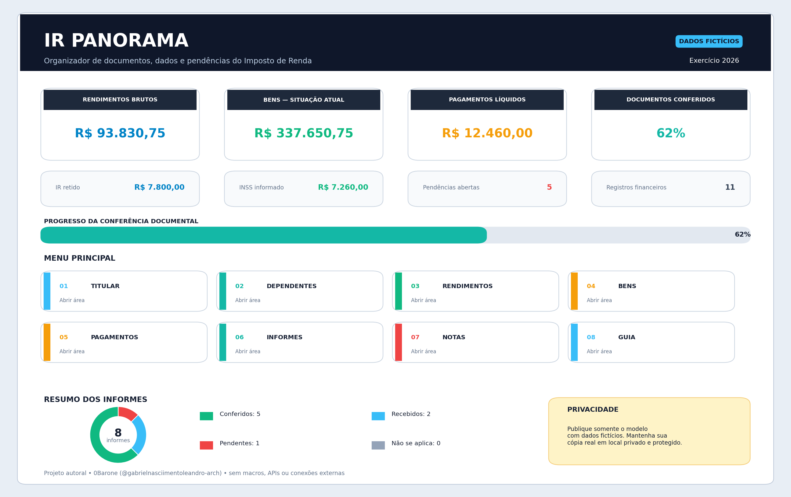
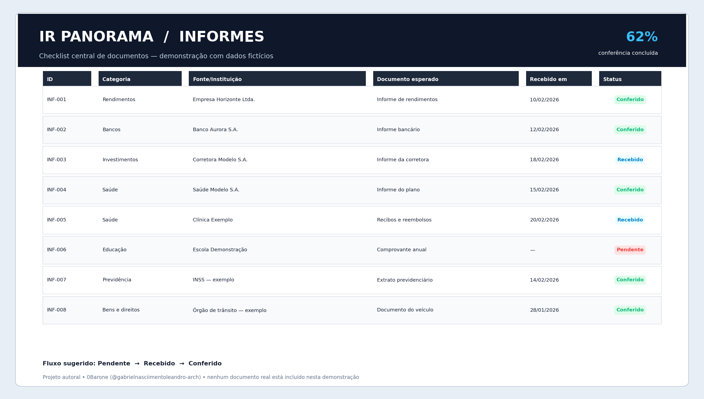

# IR Panorama — Organizador de Declaração de Imposto de Renda em Excel

Projeto autoral desenvolvido para o desafio **Criando um Organizador de Declaração de Imposto de Renda**, da DIO.

**Autor:** [0Barone (@gabrielnasciimentoleandro-arch)](https://github.com/gabrielnasciimentoleandro-arch)  
**Repositório para entrega:** `ir-panorama-excel`

O **IR Panorama** é uma ferramenta local em Excel para reunir, organizar e conferir informações usadas na preparação da declaração de Imposto de Renda. O painel centraliza dados do titular, dependentes, rendimentos, bens, pagamentos, informes e pendências sem depender de macros, API ou serviço pago.

> **Importante:** o arquivo público contém exclusivamente dados fictícios. A ferramenta é um organizador educacional e não substitui o programa oficial da Receita Federal, a legislação vigente ou orientação profissional.

## Prévia

### Painel geral



### Controle de informes



## Arquivo principal

[Baixar `ir_panorama_organizador.xlsx`](ir_panorama_organizador.xlsx)

O modelo abre com um cenário demonstrativo inteiramente fictício. Para uso pessoal, baixe o arquivo, salve uma cópia privada e apague os exemplos antes de inserir dados reais.

## Funcionalidades

- menu de navegação entre todas as telas;
- painel com ano-calendário e exercício;
- cartões automáticos para rendimentos, bens, pagamentos, retenções e pendências;
- cadastro organizado de titular e dependentes;
- tabelas filtráveis para rendimentos, bens, pagamentos, informes e notas;
- validações por listas para reduzir erros de digitação;
- cálculo automático do valor líquido de pagamentos;
- checklist documental com progresso percentual;
- alertas de notas abertas e atrasadas;
- formatação condicional para status e prioridades;
- links rápidos para páginas oficiais da Receita Federal, e-CAC e Gov.br;
- aba de guia com fluxo de uso e cuidados de segurança;
- funcionamento totalmente local, sem macro, API, assinatura ou conexão com banco de dados.

## Abas da planilha

| Aba | Finalidade |
|---|---|
| **Início** | Painel, indicadores, progresso, menu e links oficiais |
| **Titular** | Dados cadastrais e conferência de preenchimento |
| **Dependentes** | Relação, CPF, nascimento e status cadastral |
| **Rendimentos** | Fontes pagadoras, valores, IRRF, INSS e documentos |
| **Bens** | Grupo, código, descrição e comparação entre saldos |
| **Pagamentos** | Valores pagos, reembolsos e valor líquido |
| **Informes** | Checklist central dos documentos recebidos e conferidos |
| **Notas** | Pendências, prioridades, prazos e alertas automáticos |
| **Guia** | Instruções, conferência final e privacidade |
| **Apoio** | Listas internas usadas nas validações; fica oculta por padrão |

## Como usar

1. Baixe `ir_panorama_organizador.xlsx`.
2. Salve uma cópia em uma pasta privada do computador.
3. Na aba **Início**, informe o ano-calendário.
4. Substitua os exemplos fictícios pelos seus dados somente na cópia privada.
5. Preencha as abas na sequência: Titular, Dependentes, Rendimentos, Bens e Pagamentos.
6. Use **Informes** para acompanhar os documentos.
7. Registre dúvidas e ações em **Notas**.
8. Volte ao painel para acompanhar o progresso e revisar pendências.
9. Compare os dados com os documentos e use somente os canais oficiais para transmitir a declaração.

## Lógica principal

As fórmulas são armazenadas no padrão internacional do arquivo `.xlsx`. O Excel em português exibe os nomes localizados automaticamente.

### Total de rendimentos

```text
=SUM(Rendimentos!$E$9:$E$38)
```

### Total de bens na situação atual

```text
=SUM(Bens!$H$9:$H$38)
```

### Valor líquido de um pagamento

```text
=IF(COUNTA(F9:G9)=0,"",MAX(0,F9-G9))
```

A fórmula subtrai o reembolso do valor pago e impede resultado negativo.

### Progresso documental

```text
=IFERROR(
  (COUNTIF(Informes!$H$9:$H$38,"Conferido")+
   COUNTIF(Informes!$H$9:$H$38,"Não se aplica")) /
   COUNTIF(Informes!$A$9:$A$38,"<>"),
  0
)
```

### Alerta de prazo

```text
=IF(A9="","",IF(G9="Concluída","OK",IF(AND(F9<>"",F9<TODAY()),"ATRASADA","ABERTA")))
```

## Validações de dados

A aba **Apoio** fornece 16 listas para validação, incluindo:

- status de documento;
- categorias de rendimentos, bens e pagamentos;
- estados civis e unidades federativas;
- relações de dependência;
- prioridades e status de notas;
- categorias de informes;
- tipo de declaração;
- titular ou dependente.

O arquivo também possui intervalos nomeados para dados e parâmetros, facilitando manutenção e leitura das fórmulas.

## Resultado do cenário demonstrativo

| Indicador | Resultado |
|---|---:|
| Rendimentos brutos | R$ 93.830,75 |
| IRRF informado | R$ 7.800,00 |
| INSS informado | R$ 7.260,00 |
| Bens na situação atual | R$ 337.650,75 |
| Pagamentos líquidos | R$ 12.460,00 |
| Informes conferidos | 62,5% |
| Pendências abertas | 5 |

Esses números existem somente para demonstrar as fórmulas, filtros e indicadores. Não representam uma pessoa real nem uma declaração pronta para transmissão.

## Segurança e privacidade

- não publique dados reais em repositório público;
- mantenha a versão pessoal fora desta pasta do projeto;
- não envie CPF, endereço, informes ou recibos em capturas de tela;
- utilize senha ou biometria no dispositivo;
- faça backup protegido ou criptografado;
- compartilhe dados fiscais apenas por canais confiáveis;
- revise links antes de informar credenciais;
- transmita a declaração somente por canais oficiais.

A `.gitignore` também ignora pastas como `dados-reais/` e arquivos com nomes terminados em `_pessoal.xlsx`.

## Diferenciais autorais

- identidade visual própria **IR Panorama**;
- painel com indicadores e progresso em uma única tela;
- fluxo documental Pendente → Recebido → Conferido;
- separação clara entre registros financeiros e checklist de documentos;
- cálculo de reembolso e alerta de prazo;
- dez abas integradas por navegação interna;
- exemplos, valores, textos e organização criados especificamente para este projeto;
- foco explícito em privacidade e publicação segura;
- scripts reproduzíveis para geração, imagens e validação técnica.

## Validação técnica

Execute:

```bash
python scripts/verificar_planilha.py
```

O verificador confere:

- integridade ZIP/XML do arquivo `.xlsx`;
- dez abas e seis tabelas estruturadas;
- trinta validações de dados;
- 24 intervalos nomeados;
- fórmulas e resultados armazenados em cache;
- navegação interna e links oficiais;
- gráfico de status dos informes;
- valores do cenário demonstrativo;
- identificadores fictícios;
- ausência de macros e vínculos externos de pasta de trabalho;
- presença e dimensões das imagens do README.

O resultado completo está em [`docs/validacao.txt`](docs/validacao.txt).

## Reproduzir o projeto

Instale as dependências:

```bash
python -m pip install -r requirements.txt
```

Gere e valide os arquivos:

```bash
python scripts/gerar_planilha.py
python scripts/gerar_previas.py
python scripts/verificar_planilha.py
```

## Estrutura do repositório

```text
ir-panorama-excel/
├── ir_panorama_organizador.xlsx
├── README.md
├── PUBLICAR_NO_GITHUB.md
├── LICENSE
├── requirements.txt
├── .gitattributes
├── .gitignore
├── docs/
│   ├── checklist-entrega.md
│   ├── como-foi-construido.md
│   ├── descricao-entrega.txt
│   ├── seguranca-e-privacidade.md
│   ├── validacao.txt
│   ├── controle-informes.png
│   └── painel-geral.png
└── scripts/
    ├── gerar_planilha.py
    ├── gerar_previas.py
    └── verificar_planilha.py
```

## Descrição curta para o GitHub

Organizador autoral em Excel para centralizar dados, documentos, pendências e notas da declaração de Imposto de Renda.

## Licença

Código, planilha demonstrativa e documentação disponibilizados sob a licença MIT. Marcas e portais governamentais citados pertencem aos respectivos responsáveis.
